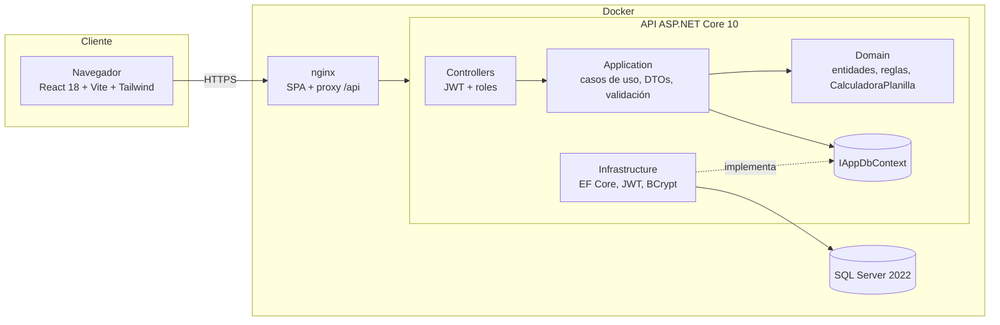

# Sistema de Planillas y RR.HH.

Sistema full-stack para la **gestión de personal y el cálculo de la planilla mensual peruana**: empleados, contratos, asistencia, vacaciones con flujo de aprobación, generación de planilla, boletas de pago imprimibles y un simulador didáctico que explica cada concepto (asignación familiar, horas extra, ONP/AFP, renta de 5ta, EsSalud).

> **Importante:** el cálculo de planilla es **didáctico**. Todas las tasas (ONP, AFP, EsSalud, UIT, RMV, sobretasas) son **configurables y referenciales**; la renta de 5ta categoría es una **aproximación** documentada. No use este sistema para pagos reales ni declaraciones ante SUNAT sin validar con un especialista.

   

---

## Características

- **Empleados**: datos personales, área, cargo, sueldo, asignación familiar y régimen pensionario (ONP o AFP con CUSPP). Búsqueda, filtros, orden y paginación en servidor. Baja lógica (las boletas se conservan).
- **Contratos**: indeterminado, plazo fijo o tiempo parcial; un único contrato vigente por empleado; alerta de contratos por vencer en 30 días.
- **Asistencia**: registro diario (presente, tardanza, falta, licencia, vacaciones) con horas extra por día. Alimenta la planilla.
- **Vacaciones**: flujo `Pendiente → Aprobada | Rechazada | Cancelada` con saldo (30 días por año de servicio), validación de solapamientos y motivo obligatorio al rechazar.
- **Planilla mensual**: generación por periodo, recálculo mientras está en *Borrador*, cierre inmutable. Cada boleta guarda una "foto" de los datos del trabajador.
- **Boleta de pago imprimible** (vista optimizada para impresión / PDF).
- **Simulador** de boleta para entender el cálculo sin guardar nada.
- **Parámetros configurables**: UIT, RMV, % ONP, % EsSalud, sobretasas de horas extra, tope de prima AFP y tasas por AFP.
- **Roles**: `Admin`, `Rrhh` y `Empleado` (este último solo ve su perfil, su asistencia, sus vacaciones y **sus** boletas de planillas cerradas).
- **Dashboard** con KPIs: empleados activos, masa salarial, neto y costo empleador del último periodo, pendientes, distribución ONP/AFP y por área.
- API documentada con **OpenAPI/Swagger**, errores **ProblemDetails (RFC 7807)**, logging estructurado JSON y endpoint `/health`.
- Frontend responsive con **modo oscuro**, estados de carga/vacío/error y validación de formularios.

## Arquitectura



La solución sigue **Clean Architecture**: el dominio no depende de nada; la aplicación depende del dominio y de abstracciones; infraestructura y API dependen hacia adentro. Detalle en [docs/arquitectura.md](docs/arquitectura.md).

## Stack y justificación

| Capa | Tecnología | Por qué |
|---|---|---|
| Backend | **ASP.NET Core 10** (C#) | Rendimiento, tipado fuerte, DI y ProblemDetails nativos. Se usa `net10.0` porque es el SDK/runtime LTS disponible (no se requiere .NET 8). |
| ORM | **EF Core 10** | Migraciones versionadas para SQL Server y proveedor SQLite para pruebas sin Docker. |
| Validación | **FluentValidation** | Reglas declarativas y testeables, separadas de los DTOs. |
| Seguridad | **JWT Bearer** + **BCrypt** | Stateless para SPA; BCrypt con sal y factor de trabajo 11. |
| Base de datos | **SQL Server 2022** | Motor corporativo habitual en áreas de RR.HH./finanzas en Perú. |
| Frontend | **React 18 + Vite + TypeScript** | Ecosistema maduro, build rápido, tipos compartidos con los DTOs. |
| Estilos | **Tailwind CSS 3** | Diseño consistente y responsive con modo oscuro por clase. |
| Formularios | **react-hook-form + zod** | Validación en cliente con buen rendimiento y tipos inferidos. |
| Pruebas | **xUnit**, **WebApplicationFactory**, **Vitest + Testing Library** | Unitarias, integración HTTP real en memoria y componentes. |

## Inicio rápido con Docker (un comando)

Requisitos: Docker Desktop.

```bash
cp .env.example .env && docker compose up -d --build
```

| Servicio | URL |
|---|---|
| Aplicación web | http://localhost:8080 |
| Swagger UI | http://localhost:5080/swagger |
| Health check | http://localhost:5080/health |

Al iniciar, la API aplica las **migraciones** de EF Core y carga **datos de ejemplo ficticios** (12 empleados, asistencia del mes anterior, solicitudes de vacaciones y dos planillas cerradas).

## Inicio sin Docker

Requisitos: **.NET SDK 10** y **Node.js 20+** (probado con Node 24 / npm 11).

### Backend

En desarrollo (`ASPNETCORE_ENVIRONMENT=Development`) el backend usa **SQLite** en un archivo local (`planillas-dev.db`), así que no necesita SQL Server:

```bash
cd backend
dotnet run --project src/Planillas.Api
# API en http://localhost:5080  ·  Swagger en http://localhost:5080/swagger
```

Para usar un SQL Server local, sobrescriba la configuración:

```bash
set Database__Provider=SqlServer
set ConnectionStrings__Default=Server=localhost,1433;Database=PlanillasRrhh;User Id=sa;Password=<su-clave>;TrustServerCertificate=True
dotnet run --project src/Planillas.Api
```

### Frontend

```bash
cd frontend
npm install
npm run dev
# http://localhost:5173  (Vite redirige /api a http://localhost:5080)
```

## Credenciales de demostración

| Rol | Correo | Contraseña | Qué puede hacer |
|---|---|---|---|
| Administrador | `admin@demo.pe` | `Demo123!` | Todo, incluido modificar parámetros legales y tasas AFP |
| RR.HH. | `rrhh@demo.pe` | `Demo123!` | Empleados, contratos, asistencia, aprobar vacaciones, generar y cerrar planillas |
| Empleado | `empleado@demo.pe` | `Demo123!` | Ver su perfil, asistencia, solicitar vacaciones y ver **solo sus** boletas |

> Son credenciales de demostración de datos ficticios. Cámbielas en cualquier despliegue real.

## Endpoints principales

| Método | Ruta | Roles | Descripción |
|---|---|---|---|
| POST | `/api/auth/login` | público | Inicia sesión y devuelve un JWT |
| GET | `/api/auth/me` | autenticado | Usuario actual |
| GET | `/api/empleados?search=&areaId=&regimen=&activo=&sortBy=&sortDir=&page=&pageSize=` | Admin, Rrhh | Listado paginado |
| POST / PUT / DELETE | `/api/empleados[/{id}]` | Admin, Rrhh | Alta, edición y baja lógica |
| GET | `/api/perfil` | autenticado | Ficha del empleado vinculado al usuario |
| GET / POST | `/api/contratos` · `POST /api/contratos/{id}/finalizar` | Admin, Rrhh | Contratos |
| GET / POST | `/api/asistencias` | GET: todos (empleado ve lo suyo) · POST: Admin, Rrhh | Asistencia diaria (upsert) |
| GET / POST | `/api/vacaciones` · `GET /api/vacaciones/saldo` | autenticado | Solicitudes y saldo |
| POST | `/api/vacaciones/{id}/aprobar` · `/rechazar` | Admin, Rrhh | Revisión de solicitudes |
| POST | `/api/vacaciones/{id}/cancelar` | dueño o gestor | Cancela una solicitud pendiente |
| GET | `/api/planillas` · `/api/planillas/{id}` | Admin, Rrhh | Planillas y sus boletas |
| POST | `/api/planillas/generar` · `/api/planillas/{id}/cerrar` | Admin, Rrhh | Generar/recalcular y cerrar |
| POST | `/api/planillas/simular` | Admin, Rrhh | Simulador de boleta |
| GET | `/api/boletas/mias` · `/api/boletas/{id}` | autenticado | Boletas (empleado: solo las suyas) |
| GET / PUT | `/api/catalogos/parametros` · `PUT /api/catalogos/afps/{id}` | GET: Admin, Rrhh · PUT: Admin | Parámetros legales y tasas AFP |
| GET | `/api/catalogos/areas` · `/cargos` · `/afps` | autenticado | Catálogos |
| GET | `/api/dashboard` | Admin, Rrhh | KPIs |
| GET | `/health` | público | Estado de la API y la BD |

Ejemplos con `curl` en [docs/guia-api.md](docs/guia-api.md).

## Cómo se calcula la planilla (resumen)

| Concepto | Regla aplicada | Parámetro |
|---|---|---|
| Asignación familiar | 10% de la **RMV** si tiene hijos | `Rmv`, `AsignacionFamiliarPct` |
| Horas extra | Valor hora = (básico + AF) / 30 / 8. Por **día**: 2 primeras h +25%, siguientes +35% | `HoraExtra25Pct`, `HoraExtra35Pct` |
| Faltas | Básico / 30 × días de falta | — |
| ONP | 13% de la remuneración computable | `OnpPct` |
| AFP | Aporte 10% + prima de seguro (hasta el tope asegurable) + comisión | tasas por AFP, `TopePrimaAfp` |
| Renta 5ta (aprox.) | (Rem. × 14 − 7 UIT) con escala 8/14/17/20/30%, ÷ 12 | `Uit` |
| EsSalud | 9% de la remuneración (mínimo sobre la RMV). **Lo paga el empleador** | `EsSaludPct` |

Las tasas son **referenciales y configurables** desde la pantalla *Parámetros* (rol Admin). Más detalle en [docs/arquitectura.md](docs/arquitectura.md#cálculo-de-planilla).

## Pruebas

```bash
# Backend: 34 unitarias + 23 de integración (API real en memoria con SQLite, sin Docker)
cd backend
dotnet test

# Frontend: 27 pruebas con Vitest + Testing Library
cd frontend
npm test
npm run lint
npm run build
```

- **Unitarias** (`tests/Planillas.UnitTests`): calculadora de planilla (ONP, AFP, tope de prima, asignación familiar, horas extra por día, faltas, EsSalud mínimo, renta de 5ta por tramos) y reglas de dominio (flujo de vacaciones, contratos, cierre de planilla).
- **Integración** (`tests/Planillas.IntegrationTests`): `WebApplicationFactory` levanta la API completa contra SQLite en memoria y prueba login, 401/403/404/409/422, validación 400 con errores por campo, paginación/filtros/orden, flujo completo de vacaciones y de planilla (generar → borrador invisible al empleado → cerrar → inmutable → boleta visible).

## Estructura de carpetas

```
sistema-planillas-rrhh/
├── backend/
│   ├── Planillas.sln
│   ├── dotnet-tools.json            # dotnet-ef como herramienta local (migraciones)
│   ├── Dockerfile                   # multi-stage, usuario no root
│   ├── src/
│   │   ├── Planillas.Domain/        # Entidades, enums, reglas y CalculadoraPlanilla (sin dependencias)
│   │   ├── Planillas.Application/   # Casos de uso (servicios), DTOs, validadores, paginación, puertos
│   │   ├── Planillas.Infrastructure/# EF Core (DbContext, configuraciones, migraciones, seed), JWT, BCrypt, reloj
│   │   └── Planillas.Api/           # Controllers, Program.cs, manejo global de errores, OpenAPI
│   └── tests/
│       ├── Planillas.UnitTests/
│       └── Planillas.IntegrationTests/
├── frontend/
│   ├── src/
│   │   ├── lib/                     # cliente API, auth, hooks, formatos, esquemas zod, tipos
│   │   ├── components/              # Layout con sidebar, DataTable, Pagination, UI base
│   │   └── pages/                   # Una página por módulo
│   ├── Dockerfile · nginx.conf
├── docs/
│   ├── arquitectura.md · modelo-datos.md · guia-api.md
│   ├── schema-sqlserver.sql         # Script SQL generado desde las migraciones
│   └── decisiones/                  # ADRs
├── docker-compose.yml · .env.example
└── .github/workflows/ci.yml
```

## Variables de entorno

| Variable | Dónde | Descripción |
|---|---|---|
| `MSSQL_SA_PASSWORD` | `.env` (compose) | Contraseña de `sa` de SQL Server |
| `JWT_KEY` | `.env` → `Jwt__Key` | Clave HMAC para firmar tokens (≥ 32 caracteres). En producción la API **se niega a iniciar** con la clave de ejemplo |
| `JWT_EXPIRA_MINUTOS` | `.env` → `Jwt__ExpiraEnMinutos` | Vigencia del token |
| `DB_PORT`, `API_PORT`, `WEB_PORT` | `.env` | Puertos publicados |
| `Database__Provider` | API | `SqlServer` (producción) o `Sqlite` (desarrollo/pruebas) |
| `ConnectionStrings__Default` | API | Cadena de conexión |
| `Database__InitializeOnStartup` | API | `true` aplica migraciones + seed al iniciar |
| `Cors__Origins__0` | API | Origen permitido si el frontend se sirve desde otro dominio |
| `VITE_API_URL` | frontend | Base del API (vacío = rutas relativas `/api`) |

## Roadmap

- [ ] Gratificaciones (julio/diciembre), CTS y bonificación extraordinaria.
- [ ] Renta de 5ta con el procedimiento mensual completo de SUNAT (divisores por mes y retenciones previas).
- [ ] Prorrateo por ingreso o cese a mitad de mes.
- [ ] Exportación PLAME / T-Registro y boletas en PDF firmadas.
- [ ] Auditoría de cambios (quién modificó sueldos y parámetros) y refresh tokens.
- [ ] Rate limiting en login y bloqueo por intentos fallidos.

## Qué aprenderás con este proyecto

- Organizar una solución **.NET** en capas (Domain, Application, Infrastructure, API) y por qué las dependencias apuntan hacia adentro.
- Modelar **reglas de negocio en el dominio** (máquina de estados de vacaciones, planilla inmutable) y probarlas sin base de datos.
- Escribir un **cálculo financiero como función pura** y cubrirlo con pruebas de casos borde (topes, redondeo, tramos).
- Usar **EF Core** con migraciones para SQL Server y SQLite para pruebas, y las diferencias entre proveedores (decimales en SQLite).
- Implementar **JWT con roles** y autorización a nivel de recurso ("un empleado solo ve sus boletas").
- Devolver errores consistentes con **ProblemDetails** desde un único `IExceptionHandler`.
- Hacer **pruebas de integración** reales con `WebApplicationFactory`.
- Construir una **SPA React** con rutas protegidas, cliente HTTP con manejo de token, tablas con paginación en servidor y formularios validados.
- Empaquetar todo con **Docker multi-stage**, nginx como proxy y **CI** en GitHub Actions.

## Licencia

[MIT](LICENSE) © 2026 Angel Castañeda Meza

## Autor

**Angel Castañeda Meza** — Ingeniero de Sistemas, Lima, Perú
GitHub: [@angel-cm-dev](https://github.com/angel-cm-dev)
