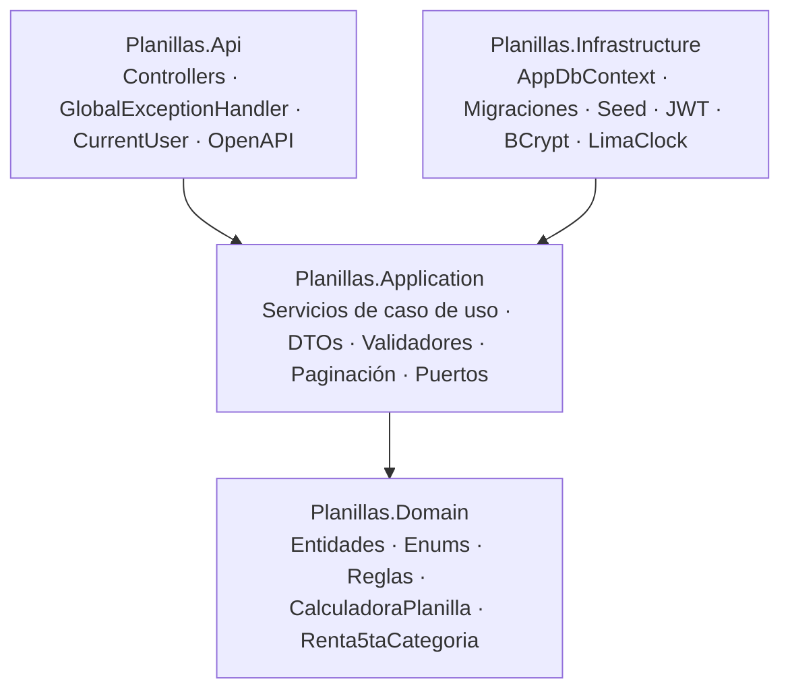
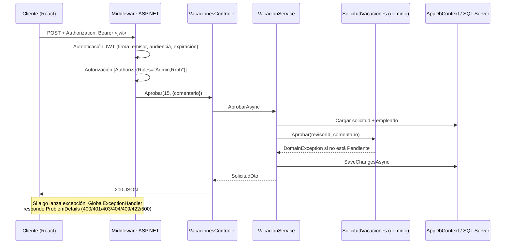

# Arquitectura

## Capas

| Proyecto | Responsabilidad | Depende de |
|---|---|---|
| **Domain** | Entidades y reglas que serían verdad en cualquier tecnología: transiciones de una solicitud de vacaciones, inmutabilidad de una planilla cerrada, cálculo de la boleta. | Nada |
| **Application** | Orquesta casos de uso: carga datos, aplica reglas del dominio, valida entrada (FluentValidation), mapea a DTOs, aplica autorización a nivel de recurso. Define *puertos*: `IAppDbContext`, `ICurrentUser`, `ITokenService`, `IPasswordHasher`, `IClock`. | Domain |
| **Infrastructure** | Implementa los puertos: EF Core (SQL Server / SQLite), JWT, BCrypt, reloj en hora de Lima, migraciones y datos de ejemplo. | Application |
| **Api** | HTTP: enrutamiento, autenticación, autorización por rol, ProblemDetails, OpenAPI, logging, health checks. Es la *composition root* (registra la DI). | Infrastructure (y transitivamente todo) |

La regla clave: **el dominio y la aplicación no conocen HTTP, SQL Server ni JWT**. Por eso la calculadora y las reglas se prueban con pruebas unitarias puras, y la API completa se prueba con SQLite en memoria.

## Flujo de una petición

Ejemplo: `POST /api/vacaciones/15/aprobar` hecho por RR.HH.

### Mapeo de errores

| Excepción | HTTP | Ejemplo |
|---|---|---|
| `FluentValidation.ValidationException` | 400 | DNI con 7 dígitos (incluye `errors` por campo) |
| `UnauthorizedException` | 401 | Contraseña incorrecta |
| `ForbiddenException` | 403 | Empleado consultando la boleta de otro |
| `NotFoundException` | 404 | Empleado inexistente |
| `ConflictException` | 409 | DNI duplicado, fechas de vacaciones solapadas |
| `DomainException` | 422 | Aprobar una solicitud ya rechazada, regenerar una planilla cerrada |
| Cualquier otra | 500 | Se registra con stack trace; al cliente solo se le da un mensaje genérico |

## Seguridad

- **Autenticación**: JWT HS256 con emisor, audiencia y expiración validados. La clave se inyecta por variable de entorno; en `Production` la API no arranca con la clave de ejemplo.
- **Autorización en dos niveles**:
  1. **Por endpoint** con `[Authorize(Roles = ...)]`.
  2. **Por recurso** en la capa de aplicación: un `Empleado` solo ve *su* asistencia, *sus* solicitudes y *sus* boletas, aunque manipule parámetros (`?empleadoId=5` se ignora).
- **Contraseñas**: BCrypt, factor 11, sal por usuario. El login responde el mismo mensaje para "usuario no existe" y "clave incorrecta" (no permite enumerar correos).
- Ocultar opciones del menú en el frontend es solo UX: la API valida todo de nuevo.

## Cálculo de planilla

`CalculadoraPlanilla.Calcular(EntradaCalculo, ParametrosPlanilla)` es una **función pura**:

1. **Asignación familiar** = RMV × 10% si `TieneHijos`.
2. **Valor hora** = (básico + asignación familiar) / 30 / horas de jornada.
3. **Horas extra** se tramifican **por día**: hasta 2 h con sobretasa de 25%, el exceso con 35%. Por eso la asistencia guarda horas extra diarias y no un total mensual.
4. **Faltas** = básico / 30 × días.
5. **Remuneración computable** = básico + AF + horas extra − faltas.
6. **ONP** = 13% · **AFP** = aporte (10%) + prima (hasta la remuneración máxima asegurable) + comisión.
7. **Renta 5ta (aproximación)**: (remuneración × 14 − 7 UIT) con escala progresiva acumulativa 8% / 14% / 17% / 20% / 30% (tramos de 5, 20, 35 y 45 UIT), dividido entre 12. El procedimiento real de SUNAT usa divisores distintos por mes y descuenta retenciones previas; aquí se simplifica a propósito.
8. **EsSalud** = 9% de la remuneración, con la RMV como base mínima. Es **aporte del empleador**: no reduce el neto.
9. Redondeo comercial a 2 decimales en cada concepto.

Todas las tasas viven en la tabla `ParametrosPlanilla` y en `Afps`, editables por el administrador. Cambiar un parámetro **no altera boletas ya emitidas**: la boleta guarda los montos calculados (snapshot).

## Decisiones principales

- [ADR-0001 · Clean Architecture en 4 proyectos](decisiones/0001-clean-architecture.md)
- [ADR-0002 · IAppDbContext en lugar de repositorios genéricos; SQLite para pruebas](decisiones/0002-dbcontext-como-puerto.md)
- [ADR-0003 · Cálculo de planilla como función pura con parámetros en BD](decisiones/0003-calculo-planilla-parametrizable.md)

## Observabilidad

- Logs estructurados: consola simple en desarrollo y **JSON** (una línea por evento con scopes y `TraceId`) en contenedores.
- Cada petición registra método, ruta, código y duración.
- Los ProblemDetails incluyen `traceId` para correlacionar un error visto por el usuario con el log.
- `GET /health` comprueba la conectividad con la base de datos.
