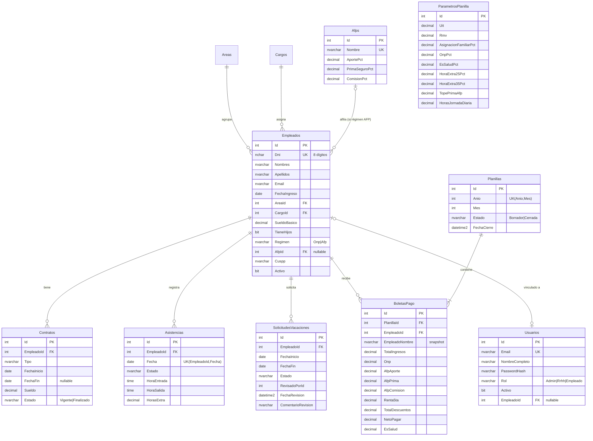

# Modelo de datos

El esquema se crea con **migraciones de EF Core** (`backend/src/Planillas.Infrastructure/Persistence/Migrations`). El script SQL equivalente para SQL Server está en [`schema-sqlserver.sql`](schema-sqlserver.sql) y puede regenerarse con:

```bash
cd backend
dotnet tool restore
dotnet ef migrations script -p src/Planillas.Infrastructure -s src/Planillas.Infrastructure -o ../docs/schema-sqlserver.sql
```

## Diagrama entidad-relación



## Tablas

| Tabla | Propósito | Reglas / índices relevantes |
|---|---|---|
| `Usuarios` | Cuentas de acceso. | `Email` único. `Rol` como texto. `EmpleadoId` vincula un usuario con su ficha (necesario para "mis boletas"). |
| `Areas`, `Cargos` | Catálogos organizacionales. | Nombre único. `Restrict` al borrar si hay empleados. |
| `Afps` | Administradoras y sus tasas (configurables). | Precisión `decimal(7,4)` para porcentajes como 1.3700. |
| `Empleados` | Ficha del trabajador. | `Dni` único (`nchar(8)`). Índice `(Activo, AreaId)` para el listado filtrado más común. |
| `Contratos` | Historial contractual. | La aplicación garantiza un solo contrato `Vigente` por empleado. |
| `Asistencias` | Un registro por empleado y día. | Índice **único** `(EmpleadoId, Fecha)`: la BD impide duplicados aunque falle el código. |
| `SolicitudesVacaciones` | Flujo de vacaciones. | Índice `(EmpleadoId, Estado)` para calcular saldos. |
| `ParametrosPlanilla` | Una sola fila con UIT, RMV y tasas. | Editable solo por Admin. |
| `Planillas` | Cabecera por periodo. | Índice **único** `(Anio, Mes)`: una planilla por mes. |
| `BoletasPago` | Detalle por empleado y periodo. | Único `(PlanillaId, EmpleadoId)`. `Cascade` desde planilla, `Restrict` desde empleado (no se borra un empleado con boletas). |

## Decisiones de modelado

- **Snapshot en la boleta**: nombre, DNI, cargo, área, régimen y AFP se copian a `BoletasPago`. Una boleta es un documento histórico; si mañana el empleado cambia de AFP, la boleta de octubre debe seguir diciendo la AFP de octubre.
- **Enums como texto**: `Rol`, `Regimen`, `Estado` se guardan como `nvarchar`. Es más legible en consultas y reportes, y no se rompe si se reordena el enum.
- **Montos `decimal(12,2)`**: nunca `float` para dinero. En SQLite (solo pruebas) se convierten a `double` porque SQLite no soporta `ORDER BY`/`SUM` sobre decimales.
- **Baja lógica** de empleados (`Activo = false`) en lugar de `DELETE`.
- **Fechas**: `DateOnly` → `date` para fechas laborales; `DateTime` UTC → `datetime2` para marcas de auditoría.

## Datos de ejemplo (seed)

Todos los datos son **ficticios** (DNI `700000xx`, correos `@empresa-demo.pe`):

- 5 áreas, 8 cargos, 4 AFP con tasas referenciales.
- 12 empleados (8 AFP, 4 ONP), con y sin hijos, sueldos desde la RMV hasta S/ 12,500.
- Un contrato vigente por empleado (uno de plazo fijo vence en 20 días → aparece en el dashboard).
- Asistencia de días hábiles del mes anterior con algunas faltas y horas extra (semilla aleatoria fija).
- Solicitudes de vacaciones pendientes, aprobadas y rechazadas.
- Dos planillas **cerradas** de meses anteriores (para que el empleado demo tenga boletas que consultar). La del mes anterior queda por generar para que pueda probar el flujo.
